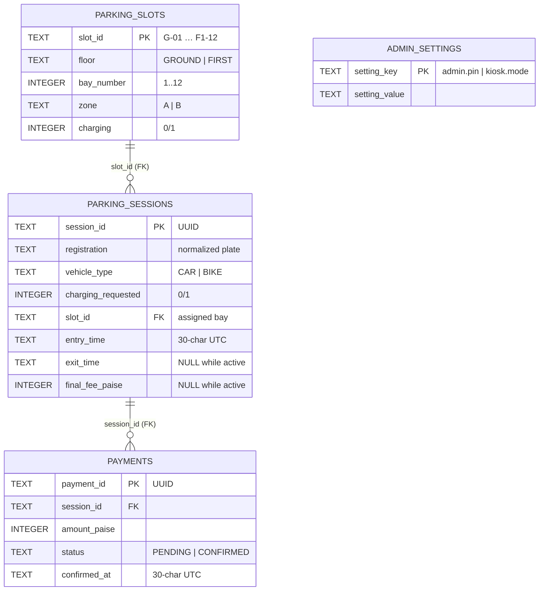

# Database guide — what to show the teacher

This document explains the database used by HiLITE Mall Smart Parking, where it lives, how to
open it, and which queries to run in the viva.

---

## 1. What database is used?

**SQLite 3** — an embedded, serverless, relational SQL database stored in **one file**.

| Item | Value |
|---|---|
| Engine | SQLite 3 (file format version 3) |
| Java driver | `org.xerial:sqlite-jdbc:3.53.4.0` |
| Access style | Plain JDBC (`Connection`, `PreparedStatement`, `ResultSet`) |
| ORM | **None** — no JPA/Hibernate. SQL is written explicitly in `repository/jdbc/` |
| Journal mode | `WAL` (write-ahead logging), enabled once at startup |
| Foreign keys | `PRAGMA foreign_keys = ON` on **every** connection, verified |
| Lock wait | `PRAGMA busy_timeout = 5000` (a writer waits up to 5 s instead of failing) |
| Transactions | Explicit `BEGIN IMMEDIATE` … `COMMIT` / `ROLLBACK` for multi-write work |

### Why SQLite for this project?

- **Zero installation** at the viva: the database is just a file, no MySQL/PostgreSQL server.
- **Relational**: real tables, primary/foreign keys, `CHECK` constraints, indexes, joins.
- **Transactional and durable**: multi-statement writes are atomic.
- **Portable**: copy the `.db` file and you have copied the whole database.
- **Honest limitation**: SQLite allows **one writer at a time**. That is fine for a kiosk demo
  running in one container, but it is not the right choice for a large multi-server system
  (there you would use PostgreSQL/MySQL).

---

## 2. Where the database file is

| Environment | File | Configured by |
|---|---|---|
| Local development (this machine) | `data/hilite-parking.db` | `hilite.db-path` in `src/main/resources/application.properties` |
| Local override | any path | `HILITE_DB_PATH` environment variable |
| Docker container | `/data/hilite-parking.db` (named volume) | `Dockerfile` / `docker-compose.yml` |
| Render (deployed site) | `/data/hilite-parking.db` | `render.yaml` |

The absolute local path for this project is:

```text
C:\Users\Zaim\Desktop\Parking Kiosk\data\hilite-parking.db
```

`data/` is **git-ignored** on purpose: the repository must not ship demo rows. The file is
created, seeded with the 24-bay layout, and validated automatically on startup by
`DatabaseInitializer`.

### Important detail about the Render free plan

`render.yaml` uses the **free** plan, which has **no persistent disk**. The application still
writes `/data/hilite-parking.db`, but Render throws that container away whenever the service
sleeps (after 15 minutes without traffic), restarts, or redeploys. On the next request the app
starts with a **fresh, empty car park** (24 seeded bays, no sessions, no payments). The free plan
is deliberate for a no-cost demo; for persistent data you would add a paid disk mounted at
`/data` (or point the app at a hosted PostgreSQL/MySQL later).

So in the viva:

- show the **live site** for the UI and the live dashboard;
- show the **local file** `data/hilite-parking.db` for the real schema and stored rows.

---

## 3. How to open the database (three ways)

### A. DB Browser for SQLite (easiest for a demo)

1. Download/install **DB Browser for SQLite** (free, <https://sqlitebrowser.org>).
2. **Open Database** → select `data/hilite-parking.db`.
3. Use the tabs:
   - **Database Structure** — tables, columns, indexes, foreign keys.
   - **Browse Data** — the actual rows (drop-down to switch tables).
   - **Execute SQL** — run any query from §6 and press ▶.

### B. `sqlite3` command line

```bash
sqlite3 data/hilite-parking.db
sqlite> .tables
sqlite> .schema
sqlite> .headers on
sqlite> .mode column
sqlite> SELECT * FROM parking_slots LIMIT 6;
sqlite> .quit
```

### C. Python (already installed here; standard library only)

```bash
python - <<'PY'
import sqlite3
con = sqlite3.connect("data/hilite-parking.db")
con.row_factory = sqlite3.Row
for row in con.execute("SELECT name FROM sqlite_master WHERE type='table' ORDER BY name"):
    print(row["name"])
print([dict(r) for r in con.execute("SELECT * FROM admin_settings")])
con.close()
PY
```

> If the application is running, prefer **read-only** access while you browse. SQLite in WAL
> mode may also create `hilite-parking.db-wal` and `hilite-parking.db-shm` next to the file;
> those are normal and are ignored by Git.

---

## 4. Schema — four tables



### 4.1 `parking_slots` — the fixed 24-bay layout (read-only reference data)

| Column | Type | Meaning |
|---|---|---|
| `slot_id` | TEXT PK | `G-01`…`G-12`, `F1-01`…`F1-12` |
| `floor` | TEXT | `GROUND` or `FIRST` (`CHECK`) |
| `bay_number` | INTEGER | 1–12 (`CHECK`) |
| `zone` | TEXT | `A` (bays 1–6) or `B` (bays 7–12); the DB enforces the mapping |
| `charging` | INTEGER | `1` only for G-03, G-08, F1-05, F1-12; `0` otherwise |

`UNIQUE (floor, bay_number)` prevents two bays with the same number on a floor.

### 4.2 `parking_sessions` — one row per stay

| Column | Type | Meaning |
|---|---|---|
| `session_id` | TEXT PK | UUID generated at entry |
| `registration` | TEXT | Normalized plate, e.g. `KL11AB1234` |
| `vehicle_type` | TEXT | `CAR` or `BIKE` |
| `charging_requested` | INTEGER | 0/1 |
| `slot_id` | TEXT FK | References `parking_slots` |
| `entry_time` | TEXT | ISO-8601 UTC, exactly 30 chars |
| `exit_time` | TEXT NULL | `NULL` = still active |
| `final_fee_paise` | INTEGER NULL | `NULL` = still active; money in paise |

**A session is active exactly when `exit_time IS NULL`** (and then `final_fee_paise` is also
NULL). The database enforces that pairing with a `CHECK`. Occupancy is **derived** from active
sessions — there is no “occupied” flag on a bay, so it cannot drift.

### 4.3 `payments` — demo payment records

| Column | Type | Meaning |
|---|---|---|
| `payment_id` | TEXT PK | UUID |
| `session_id` | TEXT FK | References `parking_sessions` |
| `amount_paise` | INTEGER | Amount in paise, never floating point |
| `status` | TEXT | `PENDING` or `CONFIRMED` |
| `confirmed_at` | TEXT NULL | Required when `CONFIRMED`, forbidden when `PENDING` |

A ₹0 exit writes **no payment row at all** (there is no fake zero payment).

### 4.4 `admin_settings` — two persisted demo settings

| Key | Default | Meaning |
|---|---|---|
| `admin.pin` | `1234` | Demo admin PIN (changeable in the DB; never displayed) |
| `kiosk.mode` | `ENTRY` | Which kiosk `/` forwards to (`ENTRY` or `EXIT`) |

---

## 5. Indexes and the constraints that encode business rules

```sql
-- Created by DatabaseInitializer.INDEX_STATEMENTS
CREATE UNIQUE INDEX ux_sessions_active_registration
    ON parking_sessions(registration) WHERE exit_time IS NULL;   -- one active stay per plate
CREATE UNIQUE INDEX ux_sessions_active_slot
    ON parking_sessions(slot_id)       WHERE exit_time IS NULL;   -- one active stay per bay
CREATE INDEX ix_sessions_entry_time ON parking_sessions(entry_time);
CREATE INDEX ix_payments_session_id ON payments(session_id);
CREATE UNIQUE INDEX ux_payments_confirmed_session
    ON payments(session_id) WHERE status = 'CONFIRMED';           -- at most one confirmed payment
```

These are **partial** indexes (`WHERE …`): they only apply to the rows that matter (active
sessions, confirmed payments). This is how the database itself prevents:

- the same plate parking twice at once;
- two cars being given the same bay;
- a session being paid twice.

Other invariants enforced in SQL, not just in Java:

- `CHECK ((exit_time IS NULL) = (final_fee_paise IS NULL))` — a session is either fully open or
  fully closed;
- `CHECK (exit_time IS NULL OR exit_time >= entry_time)` — an exit cannot precede an entry;
- `CHECK (amount_paise >= 0)` and `final_fee_paise >= 0`;
- `CHECK ((status = 'CONFIRMED' AND confirmed_at IS NOT NULL) OR (status = 'PENDING' AND
  confirmed_at IS NULL))`;
- foreign keys (enabled per connection) so a session cannot point at a missing bay and a payment
  cannot point at a missing session.

### Storage conventions

| Concept | Storage rule | Why |
|---|---|---|
| Timestamps | `uuuu-MM-dd'T'HH:mm:ss.SSSSSSSSS'Z'`, exactly 30 chars, UTC | Sortable text, exact round-trip |
| Money | integer **paise** (`final_fee_paise`, `amount_paise`) | No floating-point rounding errors |
| Java money | `BigDecimal` rupees (₹5.00 = 500 paise) | Exact arithmetic, converted at the JDBC boundary |
| Enums | uppercase TEXT + `CHECK` | Readable in the DB, validated by SQLite |
| Booleans | `0` / `1` + `CHECK` | SQLite has no boolean type |

---

## 6. Queries to run in the viva (copy-paste)

```sql
-- 1. What tables and indexes exist?
SELECT name, type FROM sqlite_master
WHERE type IN ('table','index') AND name NOT LIKE 'sqlite_%'
ORDER BY type, name;

-- 2. The 24-bay layout
SELECT slot_id, floor, bay_number, zone, charging
FROM parking_slots
ORDER BY CASE floor WHEN 'GROUND' THEN 0 ELSE 1 END, bay_number;

-- 3. Active sessions with their bay and floor
SELECT ps.registration, ps.vehicle_type, ps.slot_id, s.floor, s.zone, ps.entry_time
FROM parking_sessions ps
JOIN parking_slots s ON s.slot_id = ps.slot_id
WHERE ps.exit_time IS NULL
ORDER BY ps.entry_time;

-- 4. Occupancy per floor (derived from active sessions)
SELECT s.floor,
       COUNT(*) AS bays,
       SUM(CASE WHEN ps.session_id IS NULL THEN 0 ELSE 1 END) AS occupied
FROM parking_slots s
LEFT JOIN parking_sessions ps
       ON ps.slot_id = s.slot_id AND ps.exit_time IS NULL
GROUP BY s.floor;

-- 5. Completed stays and the payment taken
SELECT ps.registration, ps.entry_time, ps.exit_time,
       ps.final_fee_paise, p.amount_paise, p.status, p.confirmed_at
FROM parking_sessions ps
LEFT JOIN payments p ON p.session_id = ps.session_id
WHERE ps.exit_time IS NOT NULL
ORDER BY ps.exit_time DESC;

-- 6. Revenue (confirmed payments only), in paise and rupees
SELECT COUNT(*) AS payments,
       SUM(amount_paise) AS total_paise,
       SUM(amount_paise) / 100.0 AS total_rupees
FROM payments WHERE status = 'CONFIRMED';

-- 7. Settings currently stored
SELECT * FROM admin_settings;

-- 8. Integrity checks: both should return no rows
PRAGMA foreign_key_check;
SELECT session_id FROM parking_sessions
WHERE (exit_time IS NULL) <> (final_fee_paise IS NULL);

-- 9. Active stays longer than 12 hours (the long-stay rule)
SELECT registration, slot_id, entry_time,
       CAST((julianday('now')
             - julianday(replace(substr(entry_time, 1, 19), 'T', ' '))) * 86400 AS INTEGER)
           AS seconds_parked
FROM parking_sessions
WHERE exit_time IS NULL
  AND (julianday('now')
       - julianday(replace(substr(entry_time, 1, 19), 'T', ' '))) * 24 > 12;
```

---

## 7. Transactions — what the database guarantees

Multi-write operations run on **one connection** inside **one transaction**, started with
`BEGIN IMMEDIATE` (the write lock is taken up front, so a later write cannot fail on a lock
upgrade):

| Operation | Writes | File |
|---|---|---|
| Startup initialization | create tables/indexes, seed layout/settings | `DatabaseInitializer.initialize()` |
| Paid exit | update session **and** insert confirmed payment | `JdbcExitCompletionRepository.complete()` |
| Zero-fee exit | update session only (no payment) | same method with `payment = null` |
| Demo reset | delete payments, delete sessions, restore layout | `DatabaseInitializer.resetDemoData()` |

If any statement fails, everything is rolled back: the session stays active and no payment row
survives. The exit update is also **conditional**
(`WHERE session_id = ? AND exit_time IS NULL`), so two simultaneous exit attempts cannot both
close the same session.

---

## 8. Optional demo data (2 active stays + 1 completed paid stay)

The clean file has only the 24 bays and two settings. To give the teacher something to look at,
run this script with the application **stopped** (it writes valid rows using the same formats the
app uses):

```bash
python - <<'PY'
import sqlite3, uuid
from datetime import datetime, timedelta, timezone

DB = "data/hilite-parking.db"

def ts(dt):
    # exactly 30 chars: uuuu-MM-dd'T'HH:mm:ss.SSSSSSSSS'Z'
    return dt.strftime("%Y-%m-%dT%H:%M:%S.") + "000000000Z"

now = datetime.now(timezone.utc)
con = sqlite3.connect(DB)
con.execute("PRAGMA foreign_keys = ON")

rows = [
    # id, plate, type, charging, slot, entry, exit, fee_paise
    (str(uuid.uuid4()), "KL11AB1234", "CAR",  0, "G-01", now - timedelta(hours=3),  None, None),
    (str(uuid.uuid4()), "KL09EV2201", "CAR",  1, "G-03", now - timedelta(hours=14), None, None),
    (str(uuid.uuid4()), "KL07CD5678", "BIKE", 0, "G-05", now - timedelta(hours=8),
                                                     now - timedelta(hours=2), 800),
]
con.executemany(
    "INSERT INTO parking_sessions "
    "(session_id, registration, vehicle_type, charging_requested, slot_id, "
    " entry_time, exit_time, final_fee_paise) VALUES (?,?,?,?,?,?,?,?)",
    [(r[0], r[1], r[2], r[3], r[4], ts(r[5]),
      ts(r[6]) if r[6] else None, r[7]) for r in rows],
)

paid = rows[2]
con.execute(
    "INSERT INTO payments (payment_id, session_id, amount_paise, status, confirmed_at) "
    "VALUES (?,?,?,?,?)",
    (str(uuid.uuid4()), paid[0], paid[7], "CONFIRMED", ts(paid[6])),
)
con.commit()
print("Seeded:", {t: con.execute(f"SELECT COUNT(*) FROM {t}").fetchone()[0]
                  for t in ("parking_slots", "parking_sessions", "payments")})
con.close()
PY
```

Expected result: **2 active sessions** (G-01 and G-03, one of them a 14-hour long stay),
**1 completed bike stay** of 6 hours with a **₹8.00 confirmed payment** (4 chargeable hours ×
₹2) in `payments`, and the dashboard showing 2 occupied bays and one long-stay alert.

To return to a clean park: use **Reset Demo** on the admin dashboard (one transaction), or stop
the app and delete `data/hilite-parking.db*`; the next startup recreates and seeds it.
